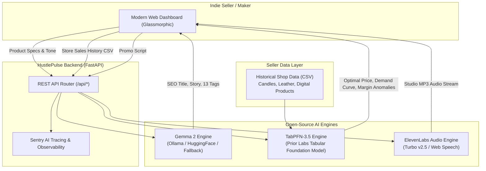

# ⚡ HustlePulse AI
### *The Autonomous, Local-First Copilot for Indie Sellers & Side-Hustlers*

[](LICENSE)
[](https://www.python.org/downloads/)
[](https://fastapi.tiangolo.com)
[](https://ai.google.dev/gemma)
[](https://priorlabs.ai)
[](https://elevenlabs.io)
[](https://render.com)

Built for the **[Hacktoberfest Open-Source AI Challenge Week 2: Side Hustle](https://dev.to/challenges/hacktoberfest-week2-2026-10-12)**.

---

## 💡 The Problem & The Mission

Side-hustlers, artisans, and boutique e-commerce sellers (Etsy, Shopify, Amazon Handmade, eBay) face three relentless barriers when growing their business:

1. **The Listing & SEO Grind**: Writing persuasive descriptions, researching 13 search tags, and finding viral hooks takes hours per item.
2. **Pricing Guesswork & Margin Erosion**: Most makers guess their prices. Underpricing destroys profitability; overpricing destroys sales volume. Traditional ML requires complex data pipelines and compute that solo makers cannot build.
3. **The "Closed AI Token Tax" & IP Leaks**: Commercial AI APIs charge per token and per month, eating 5–15% of razor-thin maker margins. Worse, sending confidential supplier bills, wholesale costs, and proprietary designs to closed cloud APIs violates seller privacy.

**HustlePulse AI** solves this with an open-source, local-first engine:
- **Gemma 2 (Open Weights)**: Writes high-converting, platform-tailored product listings, SEO tags, and TikTok/Reels hooks at **$0.00 marginal cost**.
- **TabPFN-3.5 (Tabular Foundation Model)**: Evaluates shop sales CSVs in milliseconds using Bayesian priors to forecast optimal price elasticity and flag margin anomalies.
- **ElevenLabs Voice Studio**: Turns product hooks into viral short-form video voiceovers in seconds.
- **Deploy Anywhere**: Runs 100% locally via Ollama or deploys in 1 click to **Render** via `render.yaml`.

---

## 🏛️ Architecture Overview



---

## ✨ Key Features

### 1. ✍️ Gemma Listing & SEO Studio
- **Platform Presets**: Tailored formatting for **Etsy** (storytelling & 13 tags), **Shopify** (benefits & features), **Amazon** (specs & bullets), and **TikTok Shop** (viral hooks).
- **13 High-Intent Tags**: Instantly fills Etsy's tag limit with high-converting search keywords.
- **Open Weights**: Runs on local consumer hardware via Ollama (`gemma2:2b`, `gemma2:9b`) or Hugging Face.

### 2. 📊 Dynamic Pricing & Elasticity (Prior Labs TabPFN-3.5)
- **Zero-Training In-Context Learning**: TabPFN makes Bayesian predictions directly from 10–50 rows of sales data without hyperparameter tuning or hours of training.
- **Price Elasticity Curve**: Models expected sales volume across `[-30%, -20%, -10%, 0%, +10%, +20%, +30%]` around optimal pricing.
- **Shop Anomaly Detector**: Scans historical inventory to flag severely underpriced items where labor and material costs exceed profit margins.
- **Pre-Loaded Datasets**: Comes pre-packaged with real-world datasets for Soy Candles, Leathercraft Goods, and Digital Notion Templates.

### 3. 🎙️ ElevenLabs Voice Promo Studio
- **Studio Personas**: Choose from *Rachel (Warm Artisan)*, *Adam (Luxury Commercial)*, *Bella (Upbeat Creator)*, or *Antoni (Heirloom Storyteller)*.
- **Short-Form Marketing**: Optimized for 15s–30s TikTok, Instagram Reels, and YouTube Shorts.
- **Built-in Fallback**: Features an in-browser Web Speech Synthesis player with animated waveform visualization when running offline without API keys.

---

## 🚀 Quickstart

### Prerequisites
- Python 3.11+
- Git

### 1. Clone & Install
```bash
git clone https://github.com/joegeorge022/Hacktoberfest-Week-2.git
cd Hacktoberfest-Week-2

# Create virtual environment
python3 -m venv venv
source venv/bin/activate

# Install dependencies
pip install -r requirements.txt
```

### 2. Configure Environment (Optional)
```bash
cp .env.example .env
```
*Note: HustlePulse AI is built to run immediately out-of-the-box even with zero API keys configured.*

### 3. Run Locally
```bash
uvicorn app.main:app --reload --port 8000
```
Open your browser at **`http://localhost:8000`** to access the dashboard. Interactive Swagger API documentation is available at **`http://localhost:8000/docs`**.

### 4. Run with Local Ollama (Gemma 2)
```bash
# Pull Gemma 2
ollama pull gemma2:2b

# Start Ollama
ollama serve
```
HustlePulse AI automatically connects to your local Ollama instance on port 11434.

---

## 🧪 Running Tests

The test suite validates health checks, Gemma listing generation, TabPFN tabular regressions, and voice synthesis:

```bash
pytest -v tests/test_api.py
```

---

## 🚢 Production Deployment

### Deploy to Render
HustlePulse includes a native `render.yaml` Blueprint:
1. Connect this repository to your [Render Dashboard](https://dashboard.render.com).
2. Click **New +** -> **Blueprint**.
3. Render will automatically configure the Python web service, health checks, and start command.

### Deploy with Docker
```bash
docker build -t hustlepulse-ai .
docker run -p 8000:8000 hustlepulse-ai
```

---

## 🏆 Hacktoberfest Week 2 Prize Categories

- **Best Use of Gemma ($200)**: Gemma 2 open-weight model powers all product copywriting, buyer persona profiling, and platform SEO.
- **Best Use of TabPFN ($200)**: Prior Labs' TabPFN tabular foundation model predicts price elasticity, optimal margins, and shop inventory anomalies from CSV records.
- **Best Use of Render ($200)**: Production-ready `render.yaml` and multi-stage container ready for zero-downtime deployment.
- **Best Use of ElevenLabs ($100)**: Integrates ElevenLabs Turbo v2.5 to turn generated hooks into viral audio narration for social video sales.
- **Best Use of Sentry Agent Tracing ($100)**: Instrument OpenTelemetry spans and Sentry tracing across AI model execution.

---

## 📄 License

Distributed under the MIT License. See `LICENSE` for more information.
